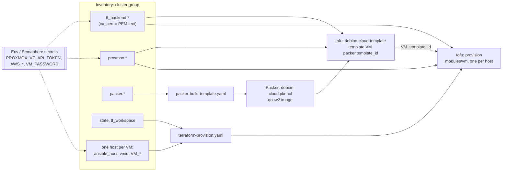

# Proxmox IAC

Provisioning VMs from a Debian cloud-init template using Ansible and OpenTofu in a Proxmox environment.

The golden image is built with Packer (qemu-guest-agent already installed). OpenTofu clones it and applies native Proxmox cloud-init (`initialization` block — no snippets). State lives in S3.

## Directory layout

```
tools/                           # Non-Ansible tool source, kept out of roles/playbooks/inventory
├── terraform/                    # OpenTofu source - runnable standalone with `tofu`, no Ansible needed
│   ├── provision/                  # Provisions cluster VMs (bpg/proxmox); state in S3
│   │   ├── modules/vm/               # One proxmox_virtual_environment_vm per VM `config` object
│   │   └── tests/                    # tofu test (mock_provider) - no live Proxmox required
│   └── debian-cloud-template/      # Imports the Packer-built qcow2, converts it to a Proxmox template
│       └── tests/
└── packer/debian-cloud/          # Packer source only - no Terraform lives here
    ├── debian-cloud.pkr.hcl
    └── scripts/, templates/, certs/, output/

roles/                          # Thin Ansible orchestration only - no infra source
├── terraform/
│   └── provision/                 # Drives tools/terraform/provision/ via community.general.terraform
└── packer/
    └── build-template/            # Drives tools/packer/debian-cloud/ + tools/terraform/debian-cloud-template/

templates/backend.hcl.j2        # Shared OpenTofu S3 backend template, used by both roles above
playbooks/                      # Entry points: terraform-provision.yaml, packer-build-template.yaml
inventory/                      # Your inventories + vault (local, not committed)
examples/inventory.example.yaml # Every accepted inventory key with its default - start here
```

`.github/workflows/opentofu.yml` runs `tofu fmt -check`, `validate`, and `test` for both `tools/terraform/` directories on every push to `main` and on PRs that touch them.

The old `roles/terraform/post-provision` role — packages/CA-cert/reboot steps that used to run after provisioning, now baked into the Packer image instead (see [§2](#2-debian-cloud-image-with-qemu-guest-agent-packer)) — is archived as `roles/terraform/post-provision.bak` (matches the `*.bak` gitignore rule, not part of the repo). CA certs for the golden image are no longer read from a file path on the runner; they come from inventory/vault (`packer.ca_certs`, see [§2](#2-debian-cloud-image-with-qemu-guest-agent-packer)), so the same inventory produces the same image on any runner, unattended.

### Variable processing
Variables for the VM and cloud-init config are processed by the `vm_prefix` variable. By default it aggregates all variables starting with the `VM_` prefix (or whatever you have chosen), and creates a map from the inventory.

For each VM the:

- **ansible_host** (IP)
- **vmid** (ID)

are mandatory to be defined one-by-one!

### Example output
```
    vm_map:
        example-cluster-01:
            config:
                agent: true
                cores: 2
                cpu_type: host
                gateway: 10.120.50.254
                memory: 2048
                password: abc1234
                storage_pool: vmdata
                storage_size_gb: 16
                storage_ssd: true
                tags:
                - example
                target_node: pvehost-001
                template_id: 9000
                user: test
            id: 5050
            ip: 10.120.50.50
            name: example-cluster-01
        example-cluster-02:
            ...
```

## Inventory at a glance

`examples/inventory.example.yaml` lists every key the playbooks read, marked REQUIRED or optional with its default. How the keys flow:



## Prerequisites
Use the devcontainer or install the utilities listed in `.devcontainer/Dockerfile` (Ansible, OpenTofu, Packer, QEMU, xorriso).

Create an inventory and a matching vault (see `inventory/`). Add these vault keys:

- `proxmox_api_token`
- `password` (cloud-init user password)
- `tf_backend_access_key`
- `tf_backend_secret_key`
- any `ca_cert_*` keys referenced by `packer.ca_certs` (PEM content, optional — see [§2](#2-debian-cloud-image-with-qemu-guest-agent-packer))

Or read them from environment variables (Semaphore secrets), as `examples/inventory.example.yaml` does: `PROXMOX_VE_API_TOKEN`, `AWS_ACCESS_KEY_ID`, `AWS_SECRET_ACCESS_KEY`, `VM_PASSWORD`.

The Proxmox API token needs `VM.GuestAgent.Audit` (PVE 9 removed `VM.Monitor`), and `VM.Migrate` if any VM uses `VM_template_node`.

## 1. Remote OpenTofu state (S3)

State is no longer stored next to the Terraform files. Configure `tf_backend` in the inventory:

```yaml
tf_backend:
  bucket: tfstate
  key: proxmox-iac/terraform.tfstate
  region: us-east-1
  endpoint: "https://s3.example.corp"   # omit for real AWS S3
  use_path_style: true                  # typical for MinIO / Ceph RGW
  use_lockfile: true
  # Prefer trusting your corp CA. Skip verify only if you must.
  # custom_ca_bundle: "/etc/ssl/certs/corp-root-ca.pem"
  insecure: false
  access_key: "{{ vault.tf_backend_access_key }}"
  secret_key: "{{ vault.tf_backend_secret_key }}"
```

OpenTofu S3 backend options used here:

- `custom_ca_bundle` — PEM file with your root/intermediate CA (also sets `AWS_CA_BUNDLE` for the Ansible task env)
- `insecure: true` — skip TLS verify (last resort)

Workspaces still apply: cluster VMs are stored under `env:/<tf_workspace>/<key>`. The Packer template uses a separate object (`packer.tf_state_key`).

### Dynamic `VM_*` → Terraform

Ansible already builds `config` dynamically from every `VM_*` host/group var. That map is passed as `vms` with `config = any`.

OpenTofu **cannot** invent resource arguments from unknown map keys. `tools/terraform/provision/main.tf` passes each VM's whole `config` object straight through to `modules/vm` as one variable, but each Proxmox attribute still needs an explicit line in `tools/terraform/provision/modules/vm/main.tf`, for example:

```hcl
# after you add support for HA in the provider schema you use:
# ha {
#   group = try(var.config.ha_group, null)
# }
```

Workflow when you add something like `VM_ha_group`:

1. Put `VM_ha_group: foo` in inventory — it appears in `vm_map.*.config.ha_group` automatically.
2. Wire `try(var.config.ha_group, …)` (or a `dynamic` block) in `modules/vm/main.tf` to the matching `bpg/proxmox` argument.
3. Until step 2 exists, the value is carried in the Ansible map but ignored by OpenTofu (no error).
4. Add a case (default + override) for the new field to `tools/terraform/provision/tests/vm.tftest.hcl`.

Optional per-VM keys already wired into `modules/vm/main.tf` include:

- `VM_memory_balloon_max` - enables ballooning: `VM_memory` becomes the guaranteed minimum (Proxmox `balloon`), this the maximum (Proxmox `memory`). Unset = fixed `VM_memory`, no balloon device. Must be >= `VM_memory`.
- `VM_template_node` - node that holds `VM_template_id`, when it differs from `VM_target_node`. On non-shared storage the provider clones on that node, then migrates the clone to `VM_target_node` (the token needs `VM.Migrate`).

- `VM_storage_discard` - disk `discard` (default `on`, so guest TRIM frees space on ZFS/LVM-thin); set `ignore` to disable.

The VM resource sets `migrate = true`: changing `VM_target_node` migrates the VM instead of re-creating it. After migrating a VM by hand in Proxmox, update its `VM_target_node` - otherwise the next apply migrates it back. To spread the clone I/O, create VMs on the template's node first, migrate them later, then update the inventory; `--check` should then show no changes.

`vms` is typed `any`, so hosts may set different `VM_*` keys; a typed `map(object(...))` cannot hold elements of different shapes.

Fully generating `.tf` from Ansible templates is possible but loses static validation and is usually worse than one explicit `try()` line per feature.

#### Naming convention

- `VM_<attr>` → a plain top-level resource argument, e.g. `VM_cores` → `config.cores`, `VM_keyboard_layout` → `config.keyboard_layout`.
- `VM_<block>_<attr>` → a leaf inside a nested provider block, e.g. `VM_network_bridge` / `VM_network_model` → the `network_device` block's `bridge` / `model`; `VM_vga_type` → `vga.type`; `VM_serial_device` → `serial_device.device`.
- Every wired setting gets a default in `tools/terraform/provision/modules/vm/main.tf` matching today's hardcoded value via `try(var.config.<key>, <default>)`, so leaving the `VM_*` var unset is always a no-op.
- `variable "vms"` is typed `any` on purpose — an `object()` schema would give type-checking, but this project favors one explicit `try()` line per feature over a second place to edit.

Currently wired this way: `keyboard_layout`, `network_bridge`/`network_model`, `serial_device`, `vga_type`, `boot_order`, `scsi_hardware` (all default to today's values — see caveats below on `scsi_hardware`).

Not parameterizable at all: `lifecycle { prevent_destroy, ignore_changes }`. Terraform requires `lifecycle` meta-argument values to be static literals, and the `for_each` module instances share the module's one `lifecycle` block — there's no per-VM override possible here, by language design.

## Bootstrap (until Semaphore is ready)

From the repo root / devcontainer (no Semaphore required):

```sh
# optional: decrypt vault interactively if .vault is not set
# echo 'vault-pass' > .vault && chmod 600 .vault

ansible-playbook playbooks/packer-build-template.yaml -i inventory/test.yaml --check
ansible-playbook playbooks/packer-build-template.yaml -i inventory/test.yaml

ansible-playbook playbooks/terraform-provision.yaml -i inventory/test.yaml --check
ansible-playbook playbooks/terraform-provision.yaml -i inventory/test.yaml
```

One-time state migrate (if local `terraform.tfstate.d` still exists). The provision role refuses to apply while that directory is present:

```sh
cd tools/terraform/provision
tofu init -migrate-state -backend-config=backend.hcl
rm -rf terraform.tfstate.d
```

If S3 already has the migrated state, delete the local directory or set `tf_backend_ignore_local_state: true`.

## Semaphore UI

Semaphore is a fine runner for **this** repo because the entrypoints are Ansible playbooks. Inventories and vault passwords can live in Semaphore (or Semaphore can clone this Git repo and use `inventory/` + a stored vault password / secret).

What it runs well:

- `playbooks/terraform-provision.yaml` — OpenTofu via `community.general.terraform` (runner needs `tofu`)
- Any later pure-Ansible roles

Caveats:

- Packer build needs Packer + QEMU (+ ideally `/dev/kvm`) on the **Semaphore agent host**. Prefer a dedicated agent for image builds; keep VM provision jobs on a lighter agent.
- Store vault secrets / S3 keys / Proxmox tokens as Semaphore secrets or env vars; do not commit them.
- Point each Semaphore template at this Git repo, the playbook path, and the inventory (Semaphore-managed inventory or Git inventory file).
- Semaphore is not a continuous reconciler; it is job/schedule/webhook driven (closer to Atlantis/CI than Argo).

Setup used with `examples/inventory.example.yaml`:

- Inventory: paste the YAML as a static inventory. Paste the root CA PEM into `root_ca_pem`; `tf_backend.ca_cert` and `packer.ca_certs` both read it, so no CA file is needed on the runner. A pasted inventory has no `group_vars/` or `certs/` next to it, so `{{ inventory_dir }}/...` paths and vault files do not work there.
- Variable Group > Secrets: add `PROXMOX_VE_API_TOKEN`, `AWS_ACCESS_KEY_ID`, `AWS_SECRET_ACCESS_KEY`, `VM_PASSWORD` as environment variables. The inventory reads them with `lookup('ansible.builtin.env', ...)`; the roles fail early if a required one is empty.
- No vault password is needed when the inventory holds no vault-encrypted values.

Semaphore itself is managed in your other repo — this project only needs a runner image with the same tools as `.devcontainer/Dockerfile`.

## 2. Debian cloud image with qemu-guest-agent (Packer)

Stock Debian cloud images do not include `qemu-guest-agent`. Without it, `bpg/proxmox` waits forever unless you disable the wait (`agent.timeout = "0m"`). Custom cloud-init snippets can install the agent on first boot, but that needs a snippets datastore and still races the provider.

Packer is used **only** to build the template:

1. Download Debian 13 genericcloud.
2. Boot it locally with QEMU and a throwaway SSH key (generated for that run, never stored).
3. Install `packer.packages` (default: `qemu-guest-agent` plus the former post-provision packages `ufw`, `chrony`, `iotop`, `nfs-common`), enable `packer.services`, and add optional CA certs supplied via `packer.ca_certs` in the inventory (each entry's `content` is written to `tools/packer/debian-cloud/certs/<name>.crt` and trusted with `update-ca-certificates`).
4. `cloud-init clean`, wipe machine-id and SSH host keys, delete the throwaway authorized_keys.
5. Upload the qcow2 through the Proxmox API (`import` content type) and convert VM `packer.template_id` to a template.

Image inputs are set under `packer:` in the inventory; any key left out keeps the default in `debian-cloud.pkr.hcl`: `timezone` (falls back to the top-level `timezone`), `iso_url`, `iso_checksum`, `packages` (replaces the default list; must keep `qemu-guest-agent`), `services`, `accelerator`, `disk_size` (GB, also used for the template disk). See `inventory/packer-debian13.yaml` for a standalone build-only inventory that runs on the local machine.

Clone-time user, password, SSH key, and network still come from OpenTofu `initialization` (Proxmox-native cloud-init, not snippets). `VM_ssh_pubkey` is optional.

### Build the template

On the Proxmox ISO/import datastore (often `local`), enable the **Import** content type.

If an old VM 9000 already exists, rename or remove it first.

Packer QEMU needs KVM. Add `"--device=/dev/kvm"` to `.devcontainer/devcontainer.json` `runArgs`, or set `packer.accelerator: none` (TCG, slow).

```sh
ansible-playbook playbooks/packer-build-template.yaml -i inventory/test.yaml
```

Point `VM_template_id` at the resulting template (9000 in the example inventory).

Re-running the playbook rebuilds the image; the new qcow2 is re-uploaded and the template VM is recreated with it (`replace_triggered_by`). Full clones of the old template are unaffected. To retry only the import with the image already in `tools/packer/debian-cloud/output/`, add `-e packer_skip_build=true`.

The Ansible post-provision play is gone: the agent is already in the image, so OpenTofu can wait for it with the default timeout.

## 3. bpg/proxmox 0.92.0 vs Proxmox VE 9.1.2

**They match.** Provider 0.92.0 (January 2026) targets Proxmox VE **9.x** as the supported line. 9.1.2 is in that range; you do not need to bump the provider for this PVE version.

Caveats that still apply:

- The new PVE 9 HA resource API is not supported by this provider.
- Guest-agent calls need the `VM.GuestAgent.Audit` privilege on the token.
- Keep `scsi_hardware = "virtio-scsi-pci"` (already set). `virtio-scsi-single` has caused agent wait hangs on PVE 9 with this provider family.

Newer 0.9x / 0.10x releases stay on PVE 9.x and only matter if you want later bugfixes, not for 9.1.2 compatibility itself.

## Provision VMs

Always use `--check` before execute.

```sh
ansible-playbook playbooks/terraform-provision.yaml -i inventory/test.yaml --check
ansible-playbook playbooks/terraform-provision.yaml -i inventory/test.yaml
```
